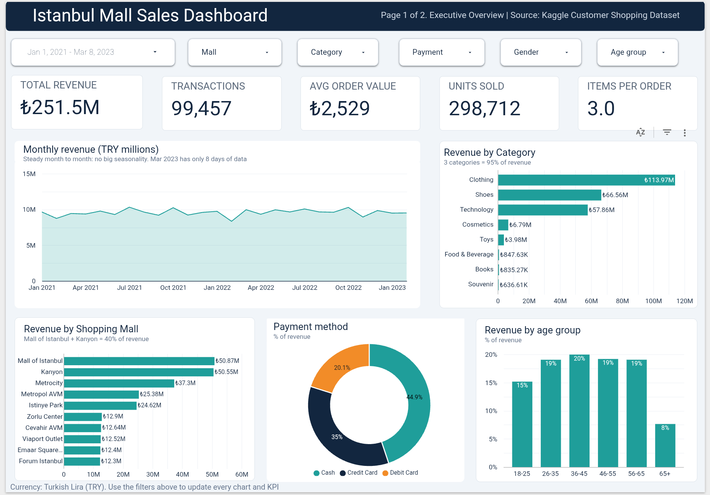
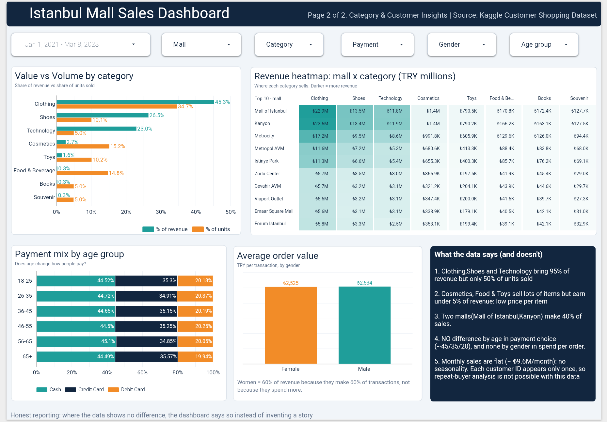

# Customer Shopping Patterns: Istanbul Malls (2021 - 2023)

An interactive Looker Studio dashboard, plus the Python and SQL analysis behind it, built on 99,457 retail transactions from 10 shopping malls in Istanbul.

**Live dashboard:** [Open in Looker Studio](https://datastudio.google.com/reporting/af819c05-980e-4ca0-a085-7312c2a706af) (works on phone and tablet, no login needed)

## Business questions

1. How much revenue do the malls make, and from which categories?
2. Which malls matter most?
3. Do customers differ by age or gender in what they spend or how they pay?
4. Are there seasonal patterns or a growth trend?

## Key findings

| Finding | Number |
|---|---|
| Total revenue (Price x Quantity) | 251.5M TRY |
| Transactions / average order value | 99,457 / 2,529 TRY |
| Clothing, Shoes and Technology share of revenue | 95% (but only 50% of units sold) |
| Cosmetics, Toys, Food & Beverage, Books, Souvenir share of revenue | about 5% (but 50% of units sold) |
| Mall of Istanbul + Kanyon share of revenue | 40% |
| Yearly revenue 2021 vs 2022 | 114.5M vs 115.4M TRY (+0.8%) |

**Where the data shows no difference, I report it:**
- Payment mix is almost identical in every age group (about 45% cash, 35% credit card, 20% debit card).
- Women generate 60% of revenue because they make 60% of transactions. Average order value is the same (2,525 vs 2,534 TRY).
- Monthly revenue is flat (about 9.6M TRY per month), so there is no clear seasonality.
- Every Customer_ID appears only once, so repeat-purchase and RFM analysis are not possible with this dataset.

## Data audit: what I fixed from my first version

My first version of this project (Excel and Power BI) calculated revenue as `SUM(Price)`. Price is the price per **unit**, so this ignored quantity.

| Metric | First version (wrong) | Corrected |
|---|---|---|
| Total revenue | 68.5M | **251.5M TRY** |
| Average order value | 689 | **2,529 TRY** |

I also fixed these problems:
- The currency was shown as "$". The dataset is in Turkish Lira (TRY).
- March 2023 contains only 8 days of data, which made the monthly trend look like a sales crash. It is now flagged as a partial month.
- Mall was never used in the first version. It is now a filter and a main chart.
- Claims that the data does not support (seasonal spikes, young customers preferring digital payments, repeat-customer loyalty) were removed.

## Method

1. **Clean (Python, pandas):** removed the leading space in the ` price` column name, converted price text such as `"$1,500 "` to numbers, parsed dates (M/D/YYYY), created `revenue`, `age_group` and `month`. Checks: 0 missing values, 0 duplicate invoices.
2. **Analyse (SQL, DuckDB):** five queries in `analysis_queries.sql` for KPIs, mall share, category value vs volume, payment mix by age group and yearly revenue.
3. **Visualise (Looker Studio):** a two-page report with report-level filters for date, mall, category, payment method, gender and age group.

## Files

| File | What it is |
|---|---|
| `shopping_clean.csv` | Cleaned dataset used by the dashboard |
| `customer_shopping_data.csv` | Original Kaggle data |
| `shopping_analysis.ipynb` | Cleaning and SQL analysis notebook |
| `analysis_queries.sql` | The five SQL queries |
| `data_dictionary.md` | Column descriptions |
| `dashboard_page1.png`, `dashboard_page2.png` | Dashboard screenshots |

## Tools

Python (pandas), SQL (DuckDB), Google Sheets, Looker Studio.

## Data source

Kaggle: [Customer Shopping Dataset - Retail Sales Data](https://www.kaggle.com/datasets/mehmettahiraslan/customer-shopping-dataset). The data looks synthetic (very evenly spread), so the findings describe this dataset, not real Istanbul retail.

## Contact

Sagar Parmar | [LinkedIn](https://www.linkedin.com/in/sagar-parmar2025) | [Portfolio](https://sagarparmar.pages.dev)
